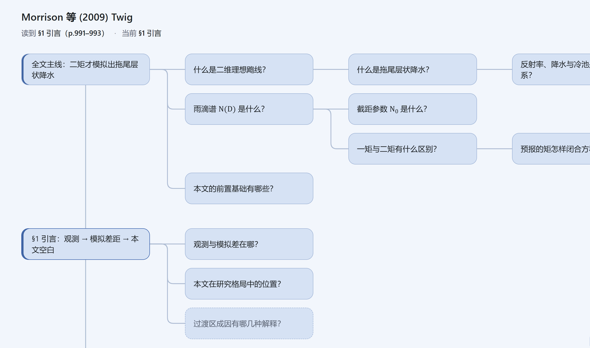
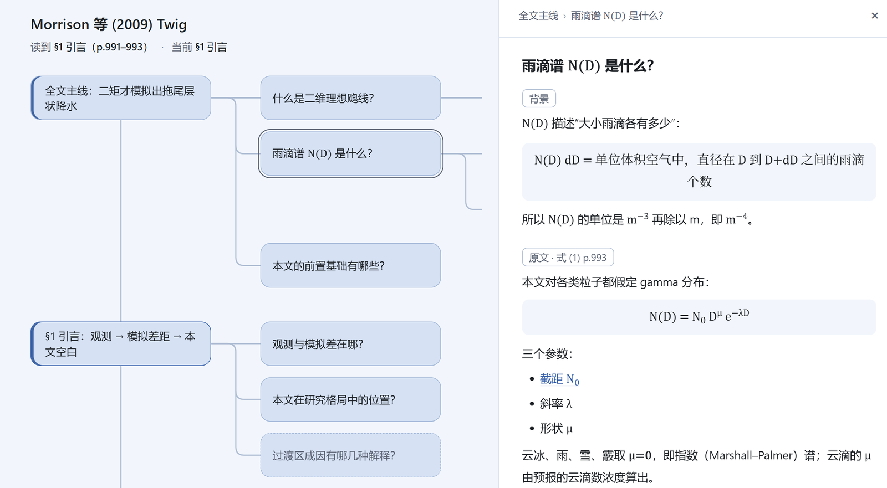
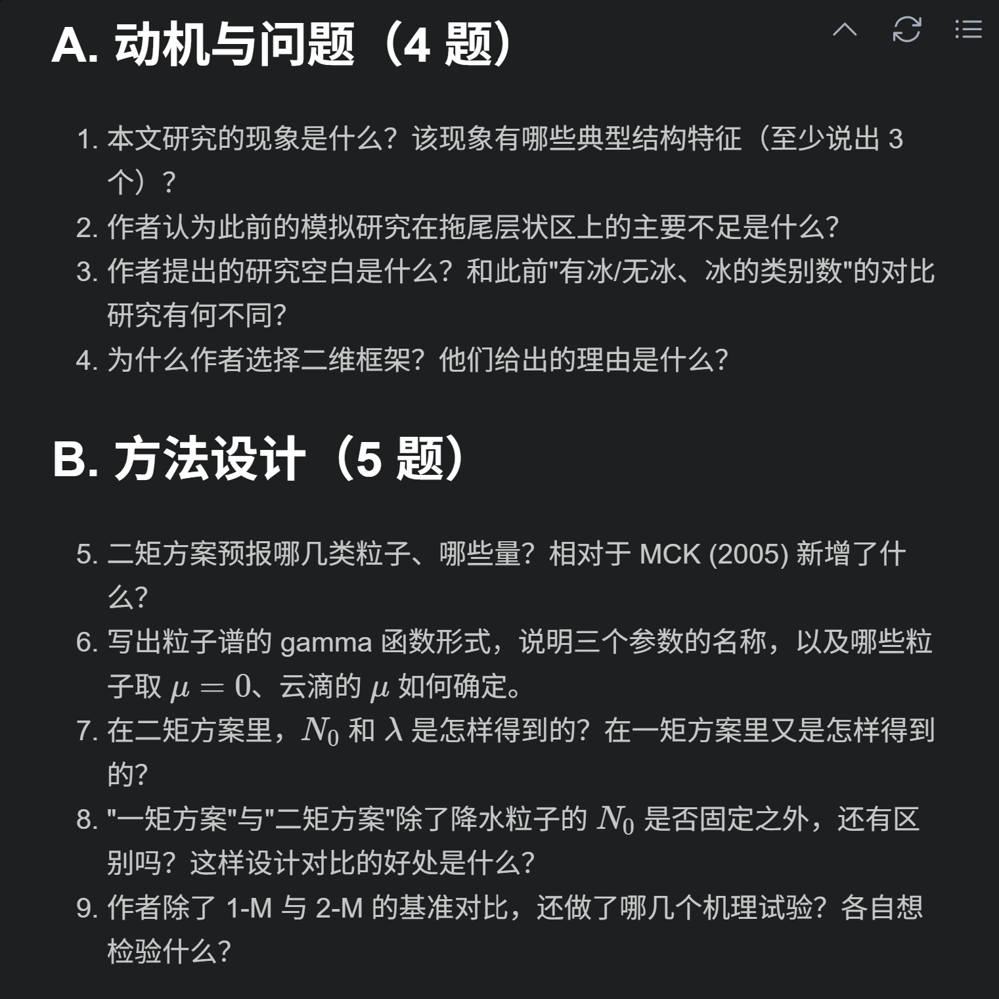
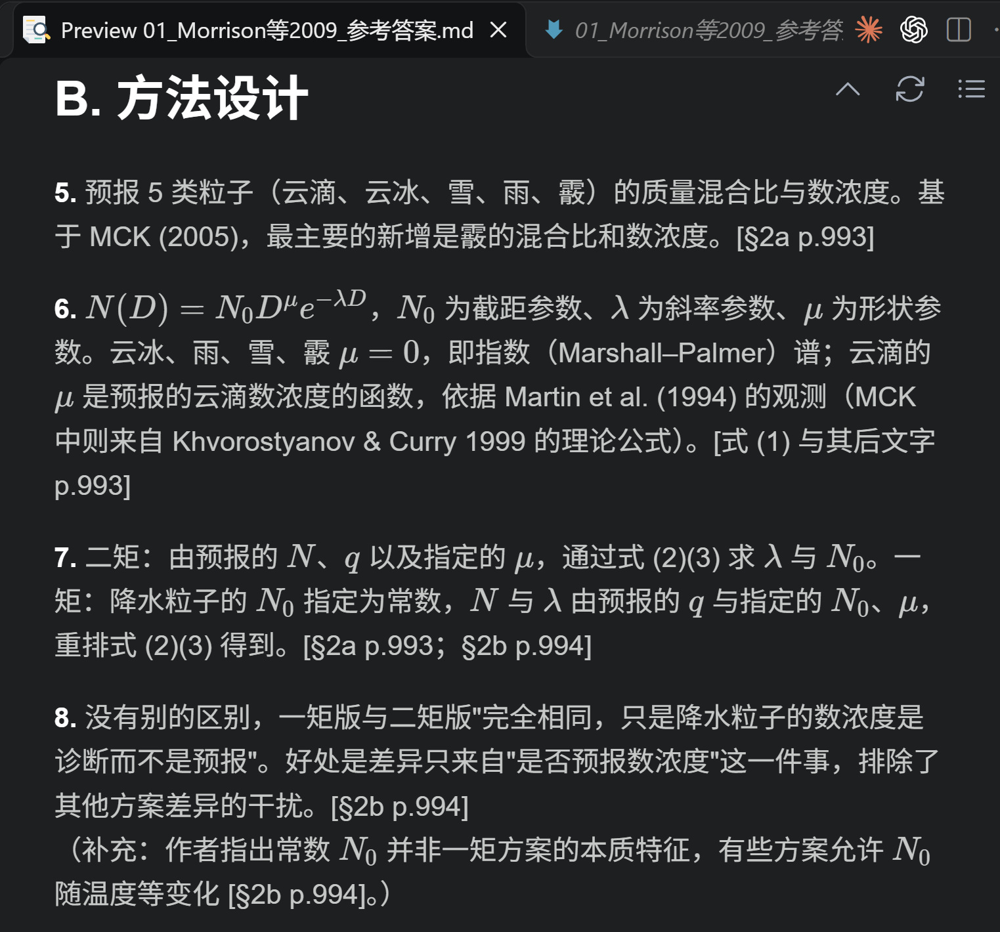
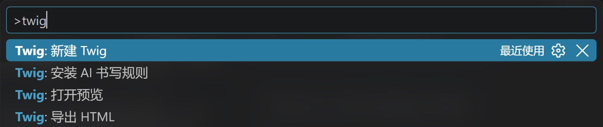
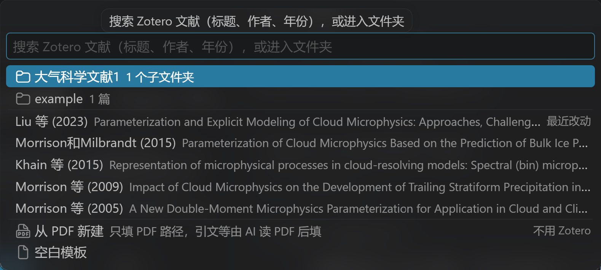
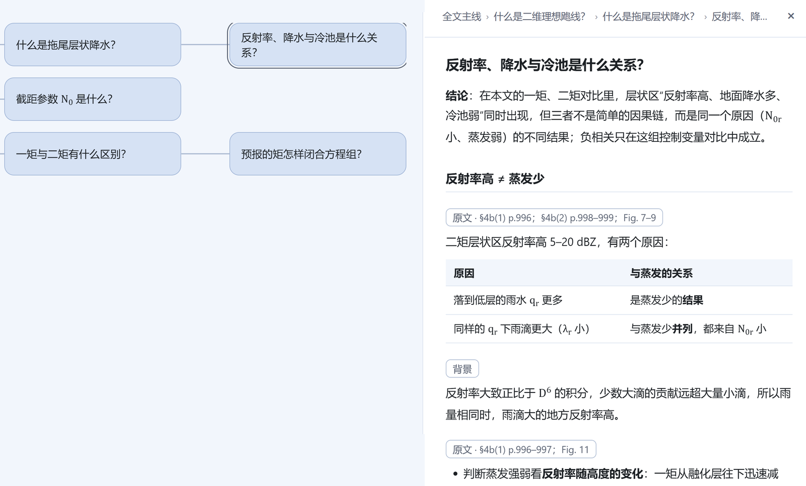

# Twig 问枝

用 AI 读论文时，常遇到三个问题：

1. AI 的回答不够精炼、不好理解，有时还不真实；
2. 看完 AI 的总结心里没底，不知道自己算不算真的读懂了；
3. 读新领域的论文时概念太多，一追问就是两三层，对话越拉越长，回不到主线。

Twig 把阅读过程画成一棵树：论文各节沿主干竖排，追问向右分叉，箭头由先懂的概念指向后懂的，虚线连起联想到的相关问题。每个节点有一张知识卡片，复习时顺着箭头就能看出“先懂什么，才能懂什么”。

## 配合 AI 读论文

扩展自带一套给 AI 的书写规则（skill `twig`），Claude Code、Codex、Gemini、Copilot 等能读写本地文件的 AI 按规则一边讲解、一边维护这棵树：

- 详细讲解留在对话里，树里只记整理好的结论；
- 卡片每段标明来自原文哪一节、哪张图、哪一页，AI 推出的内容标【推断】；引到其他论文时附 DOI 链接，点一下就能查到原文；
- 进度记在文件里，开新对话也能接着读；
- 读完出 20–30 道题和参考答案，分成两个文件，先自己作答再对照。

<table><tr>
<td> 提问清单：由浅入深分层</td>
<td> 参考答案：逐题带出处</td>
</tr></table>

## 接入文献库

用 Zotero 或 `.bib` 文件（JabRef 维护的，或从 EndNote 等导出的）管理文献的，新建时直接从文献库选论文，引文、PDF 路径和起始页码自动填好；Twig 文件按文献库的分类放进对应的文件夹。不用文献库也可以，选一篇 PDF 就能开始读。

## 开始之前：搭好工作台

AI 只能顺畅读写 VSCode 工作区（打开的那个文件夹）里的文件，所以 Twig 文件和论文最好都放在工作区里；文献库的数据库则不要放进云盘，同步交给它自带的功能。按自己的情况选一种布局：

| 你的情况 | 推荐布局 |
|---|---|
| 用 Zotero，不用云盘 | 建一个 `科研/` 文件夹作为工作区，里面放 Zotero 数据文件夹和 `Twig阅读整理/` |
| 用 Zotero，也用云盘 | `云盘/科研/` 作为工作区，里面放 `Twig阅读整理/`；Zotero 数据文件夹留在本地 |
| 用 `.bib` 文件，或不用文献库 | `科研/` 作为工作区，里面放 `.bib`、论文 PDF 和 `Twig阅读整理/`；用云盘时整个放进云盘 |

每种布局怎么搭、为什么这样搭，见[工作台搭建](docs/workspace.md)。不想按这些布局放的，可以自己指定位置，见下文“个性化”。

## 使用说明

### 1. 安装

1. 在扩展商店安装 Twig 问枝。
2. 第一次启动时选“安装（推荐）”，把书写规则装给 AI。规则写入家目录下的 `.claude/skills/twig`，本机装有 Codex、Gemini 时也写入它们的 `skills` 目录。当时没装的，可以在命令面板运行“Twig：安装 AI 书写规则”。
3. 安装 [PDF Viewer](https://marketplace.visualstudio.com/items?itemName=mathematic.vscode-pdf) 扩展，点出处时才能跳到原文。
4. 接入文献库：
   - Zotero（需要 7 以上）：在 Zotero 设置 → 高级 勾选“允许此计算机上的其他应用程序与 Zotero 通信”。
   - `.bib` 文件：在设置（`Ctrl + ,`）中把 `twig.library` 选为 `bibtex`，`twig.bibFile` 填 `.bib` 文件的路径。

### 2. 使用

Twig 的命令都在命令面板（Ctrl + Shift + P）里，输入 twig 就能找到。

**新建**：命令面板运行“Twig：新建 Twig”，按文献库的分类逐层找到论文，或直接搜索。选中后，引文、PDF 路径和起始页码自动填好，文件放进 `Twig阅读整理` 下与分类对应的子文件夹。不用文献库的，选最下面的“从 PDF 新建”，选好 PDF 就能开始读，引文等由 AI 读 PDF 后填。

**阅读**：

1. 对 AI 说“开始读这篇论文”。AI 会先核对文件开头的 `firstPage`（PDF 第 1 页的期刊页码，决定能否跳对页），再写全文主线，之后随你追问往树上加节点。
2. 打开 `*_twig.md`，点编辑器右上角的树形图标，旁边出现树状图，AI 改文件后自动刷新。点方框打开知识卡片；Ctrl + 滚轮缩放，按住空白处拖动。
3. 卡片里的页码和图表号可以点，打开论文并定位到出处那一行。

**读完**：对 AI 说“读完了，出题”，得到提问清单和参考答案。想分享给别人，右键 `*_twig.md` →“导出 HTML”，生成一个独立网页。

**整理**：在文献库里调整了分类后，运行“Twig：按文献库分类整理文件夹”，Twig 文件连同提问清单、参考答案移到论文现在所在分类的文件夹。

### 3. 个性化

- **AI 的风格**：在 `skills/twig/` 下新建 `个人偏好.md`，写几条要求，例如“新术语先用一句话解释”。不要改其他文件，扩展升级时会被覆盖。
- **存放位置**：不按上文的推荐布局时，在设置中搜索 `twig.folder`，填一个文件夹，新建的 Twig 文件都放在它下面：从文献库新建的按分类建子文件夹，其他方式新建的放在当前打开的子文件夹或根目录。

### 4. 卸载

卸载扩展并重启 VSCode 后，书写规则自动删除，只保留 `个人偏好.md`；你的 Twig 文件不受影响。

## 许可

MIT
