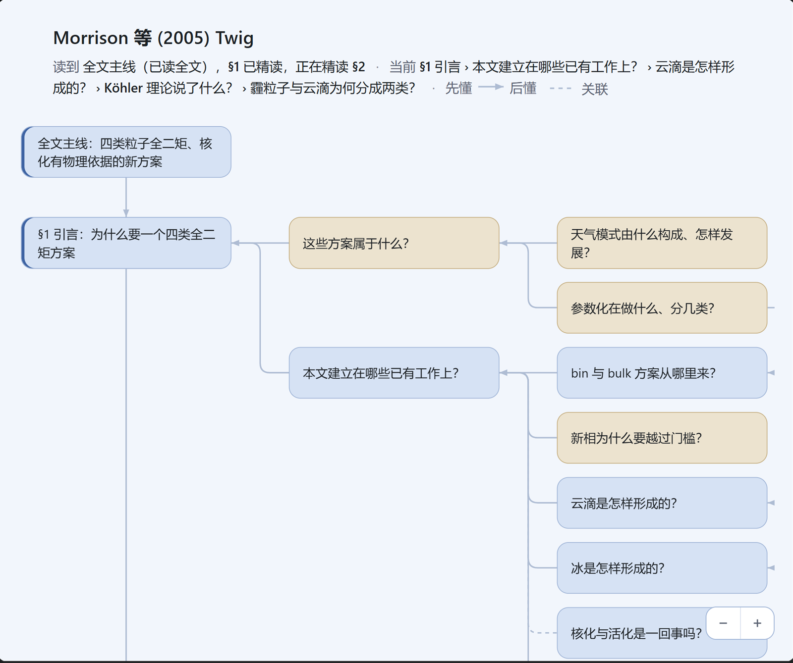
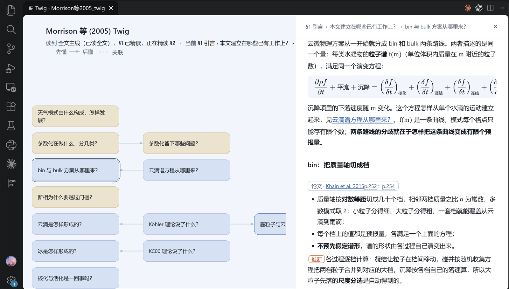
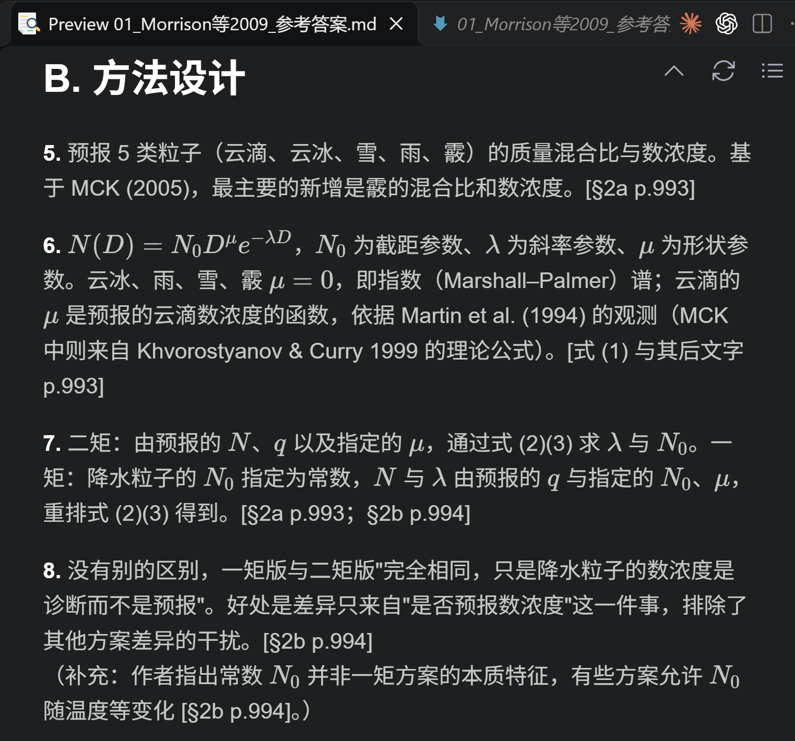
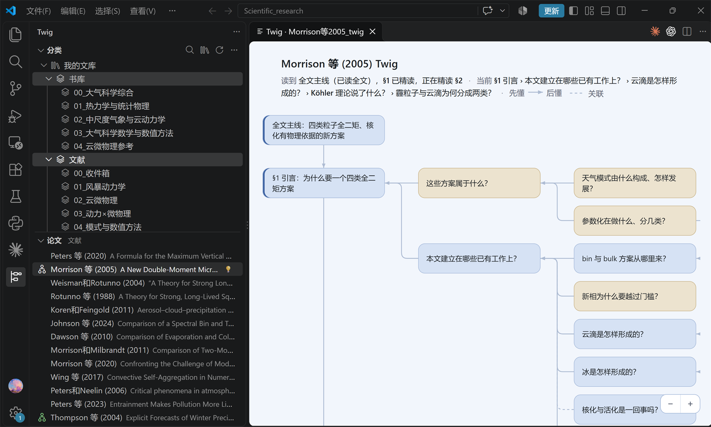
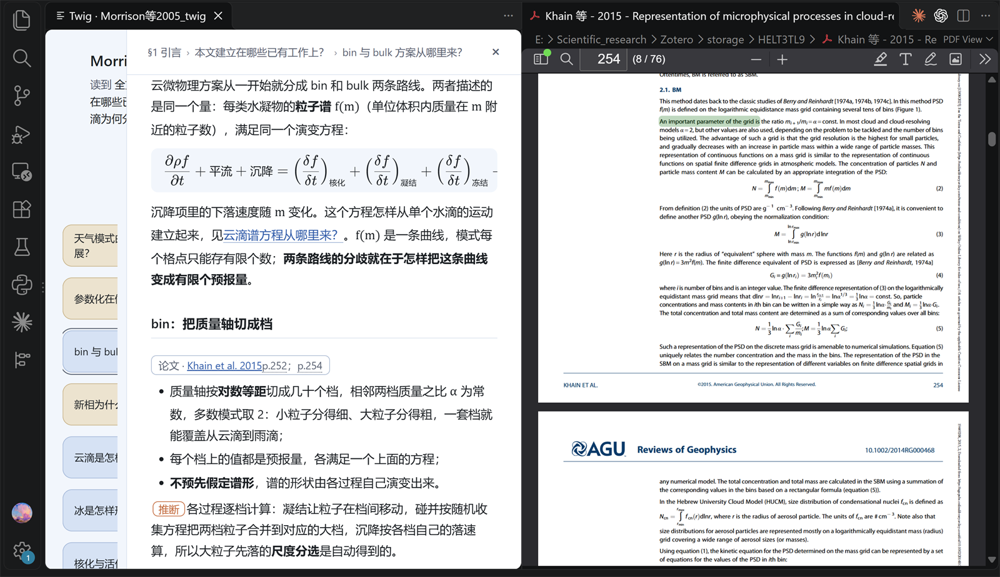

# Twig 问枝

用 AI 读论文时，常遇到三个问题：

1. AI 的回答不够精炼、不好理解，有时还不真实；
2. 看完 AI 的总结心里没底，不知道自己算不算真的读懂了；
3. 读新领域的论文时概念太多，一追问就是两三层，对话越拉越长，回不到主线。

Twig 把阅读过程画成一棵树：论文各节沿主干竖排，追问向右分叉，箭头由先懂的概念指向后懂的，虚线连起联想到的相关问题。每个节点有一张知识卡片，复习时顺着箭头就能看出“先懂什么，才能懂什么”。

## 配合 AI 读论文

扩展自带一套给 AI 的书写规则（skill `twig`），Claude Code、Codex、Gemini、Copilot 等能读写本地文件的 AI 按规则一边讲解、一边维护这棵树：

- 详细讲解留在对话里，树里只记整理好的结论；
- 卡片每段标明来自原文哪一节、哪张图、哪一页，AI 推出的内容标【推断】；引到其他论文时附 DOI 链接，点一下就能查到原文；
- 进度记在文件里，开新对话也能接着读；
- 读完出 20–30 道题和参考答案，分成两个文件，先自己作答再对照。

<table><tr>
<td> 提问清单：由浅入深分层</td>
<td> 参考答案：逐题带出处</td>
</tr></table>

读的时候想到点子，可以接着和 AI 讨论：它把想法拆成假设、已知结论和推论，查本机论文和网络上的证据，指出漏洞和适用范围；成形后写成一篇灵感笔记，挂在引出它的那篇论文下，与追问图互相链接。

## 侧栏：从文献库开始

Twig 以论文为中心。活动栏里的 Twig 侧栏和 Zotero 一样分两栏：上面“分类”是文献库的分类树，下面“论文”列出选中分类里的论文。已有 Twig 的论文前面有树形图标，有灵感笔记的行尾有 💡，单击就打开；还没读的点右边的 + 新建，引文、PDF 路径和起始页码自动填好。

文献库可以是 Zotero、`.bib` 文件（JabRef 维护的，或从 EndNote 等导出的），也可以是放论文 PDF 的文件夹：不用文献软件时，子文件夹就是分类。

## 开始之前：搭好工作台

AI 只能顺畅读写 VSCode 工作区（打开的那个文件夹）里的文件，所以 Twig 文件和论文最好都放在工作区里；文献库的数据库则不要放进云盘，同步交给它自带的功能。按自己的情况选一种布局：

| 你的情况 | 推荐布局 |
|---|---|
| 用 Zotero，不用云盘 | 建一个 `科研/` 文件夹作为工作区，里面放 Zotero 数据文件夹、`Twig追问整理/` 和 `Twig灵感笔记/` |
| 用 Zotero，也用云盘 | `云盘/科研/` 作为工作区，里面放 `Twig追问整理/` 和 `Twig灵感笔记/`；Zotero 数据文件夹留在本地 |
| 用 `.bib` 文件，或不用文献软件 | `科研/` 作为工作区，里面放 `.bib` 或放论文 PDF 的 `论文/`，以及 `Twig追问整理/` 和 `Twig灵感笔记/`；用云盘时整个放进云盘 |

每种布局怎么搭、为什么这样搭，见[工作台搭建](docs/workspace.md)。不想按这些布局放的，可以自己指定位置，见下文“个性化”。

## 使用说明

### 1. 安装

1. 在扩展商店安装 Twig 问枝。
2. 第一次启动时选“安装（推荐）”，把书写规则装给 AI。规则写入家目录下的 `.claude/skills/twig`（Copilot 也读这里），本机装有 Codex、Gemini 时也写入它们的 `skills` 目录。当时没装的，可以在命令面板（Ctrl + Shift + P）运行“Twig：安装 AI 书写规则”。
3. 安装 [PDF Viewer](https://marketplace.visualstudio.com/items?itemName=mathematic.vscode-pdf) 扩展，点出处时才能跳到原文。
4. 用 Zotero（需要 7 以上）的，在 Zotero 设置 → 高级 勾选“允许此计算机上的其他应用程序与 Zotero 通信”。

### 2. 使用

**选择文献库**：点活动栏的 Twig 图标打开侧栏，在“分类”的标题栏点“选择文献库”，选 Zotero、`.bib` 文件或 PDF 文件夹；后两种接着选文件或文件夹，不用进设置。

**新建**：在“分类”里选一个分类，再在“论文”里点那篇论文右边的 +；也可以点标题栏的放大镜搜索文献。文件平铺放在 `Twig追问整理` 中；同一篇论文已有 Twig 时直接打开，不重复新建。

**阅读**：

1. 对 AI 说“开始读这篇论文”。AI 会先核对文件开头的 `firstPage`（PDF 第 1 页的期刊页码，决定能否跳对页），再写全文主线，之后随你追问往树上加节点。
2. 单击侧栏里的论文，或在 `*_twig.md` 编辑器右上角点树形图标，旁边出现树状图，AI 改文件后自动刷新。点方框打开知识卡片；Ctrl + 滚轮缩放，按住空白处拖动。
3. 卡片里的页码和图表号可以点，打开论文并定位到出处那一行；卡片也能链接网页和本机文件（笔记、代码等），点击直接打开。

**灵感笔记**：读的时候想到点子，对 AI 说“我有个想法……”。讨论到成形后，在侧栏右键那篇论文 →“新建灵感笔记”，填简题，让 AI 整理成文。一篇论文可以有多条，都放在 `Twig灵感笔记` 中。

**读完**：对 AI 说“读完了，出题”，得到提问清单和参考答案。想分享给别人，在侧栏右键论文 →“导出 HTML”，生成一个独立网页。

### 3. 个性化

- **AI 的风格**：在 `skills/twig/` 下新建 `个人偏好.md`，写几条要求，例如“新术语先用一句话解释”。不要改其他文件，扩展升级时会被覆盖。
- **存放位置**：不按上文的推荐布局时，在设置中搜索 `twig.folder`，填一个文件夹，新建的 Twig 文件都平铺放在里面。灵感笔记的位置填在 `twig.ideaFolder`。

### 4. 卸载

卸载扩展并重启 VSCode 后，书写规则自动删除，只保留 `个人偏好.md`；你的 Twig 文件不受影响。

## 从源码构建

扩展是纯 JavaScript，不用编译，也没有第三方依赖，clone 下来不用 `npm install`。

- **调试**：用 VSCode 打开仓库文件夹，按 F5，在弹出的“扩展开发宿主”窗口里试用。
- **打包**：装好 Node.js（20 以上），在仓库根目录运行 `npx @vscode/vsce package`，得到 `twig-paper-reading-版本号.vsix`。安装时运行 `code --install-extension twig-paper-reading-版本号.vsix`，或在扩展视图右上角的 … 菜单里选“从 VSIX 安装”；商店里搜不到 Twig 的编辑器（如 Cursor、VSCodium）也这样装。
- `skill/build.cjs` 不是扩展的构建脚本：它把 `_twig.md`、`_idea.md` 生成独立网页，“导出 HTML”用的就是它。

## 许可

MIT
